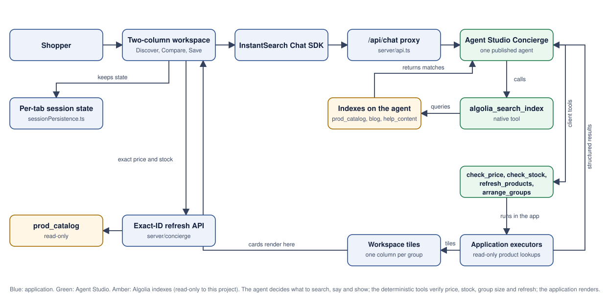
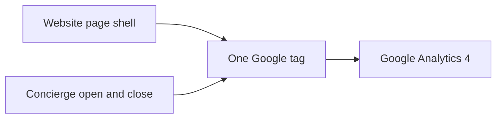

# JTV Concierge demo

A public JTV-style storefront for exploring jewelry through conversation. One Concierge in Algolia's Agent Studio learns the shopper's preferences, searches the read-only JTV catalogue and guidance, and helps them discover pieces. The shopper sees conversation beside a single product canvas; clicking a tile opens the product page.

**Status:** This repository holds the baseline of 2026-10-22: the application on `main` and the Concierge agent are the same in local development and in production ([the baseline](storefront/docs/BASELINE.md)), and all future work starts from it. The Concierge is live on the public [main Vercel URL](https://jewellerytv.vercel.app/) with no Vercel login. Full anniversary, replacement, guardrail and continuity acceptance (Plan 3.1) remains open; no checkout or purchase verification exists.

**Public hosted app:** [jewellerytv.vercel.app](https://jewellerytv.vercel.app)

**GitHub:** [algolia/jewellerytv](https://github.com/algolia/jewellerytv)

## How it works



The [editable workflow source](storefront/docs/architecture.mmd) keeps the diagram's source. The detailed developer view, including both safety checks and how a change reaches production, lives in the public [documentation pages](storefront/public/docs/index.html). The static SVG uses system fonts and self-contained shapes, so GitHub can render it without a separate PNG fallback.

The Concierge owns interpretation, tone, questions, search decisions, curation and explanations. The application owns state, identity, source boundaries, exact arithmetic and display validation. The Concierge searches the catalogue, blog and Help content with Agent Studio's own `algolia_search_index` tool and calls two deterministic client tools the application executes (`refresh_products`, `arrange_groups`), so stock, group size, bounds and refresh are tested code while judgment stays with the agent. `arrange_groups` accepts inclusive-bound flags and returns each piece's name and price. The three earlier client-side tools (`update_shopping_state`, `retrieve_evidence`, `present_choices`) were retired when this baseline replaced them in production on 2026-10-22. Product, blog and Help indices and all index settings remain read-only. The app does not contain canned Concierge replies or a second conversational router.

The browser keeps the current shopping mission in session storage. The workspace is one discovery surface (the 2026-10-22 client simplification removed the Discover/Compare/Save tabs, save actions, compare toggles and the in-canvas preview): the agent's arranged groups render as one column of cards per group, at most three groups with two cards each; each tile is an image, the name and one price, and clicking it opens the product detail page, where stock, sizes and checkout live. The tiles are exactly what the deterministic arrange tool verified, so an out-of-stock or out-of-bounds piece never renders. When the output guardrail withholds an answer, the tiles the tool already verified stay visible beside the fixed system notice. When a tool call fails mid-turn but the model recovers with real results and an answer, the turn is shown instead of a failure notice. Save and Compare remain jtv.com features (Love List, cart), and the Concierge can still discuss looks and differences in conversation. Agent Studio memory is off, and there is no login or cross-device state.

The app displays incoming Concierge text as it streams, then commits the answer and product cards only after a completed turn. Group and item counts are arranged by the deterministic group tool (default three groups of two) and reported with a shortfall when fewer qualify.

## Google Analytics

The website installs one Google tag, `G-GVSHHN3EJQ`, in the shared HTML document head. Concierge visibility events reuse that tag: `concierge_open` and `concierge_close` contain only fixed widget labels. Conversation text, preferences and tool records are not supplied by these custom events. Analytics failures do not interrupt the widget.



SPA history-based page views are controlled by the GA4 web stream's enhanced measurement. The application does not send a second manual route page-view event. Verify real event receipt in GA after release; local fixture tests establish wiring and deduplication only.

## Run locally

Use Node.js 24 and npm. Supply the server-side Algolia values and published Concierge agent ID in the project-root `.env.local` as described in [the environment template](storefront/.env.example). The two variables name two different agents with identical definitions; see [the baseline](storefront/docs/BASELINE.md). Do not put credentials in `VITE_*` variables or Git.

```sh
cd storefront
npm ci
npm run dev
```

Open `http://localhost:5173`. The local API runs on `127.0.0.1:5174`. The [storefront guide](storefront/README.md) covers the source modules and checks. The [deployment guide](storefront/docs/deployment.md) covers the public Vercel snapshot and rollback.

## Verification and limits

The local build uses TypeScript, Vitest, ESLint and dependency checks. The live Concierge and guardrail must be judged through actual connected browser journeys. A successful tool receipt, a green unit suite or a deployed page is not proof of a complete shopping experience. The baseline's agent fingerprints are recorded in [`storefront/scripts/baseline/baseline.json`](storefront/scripts/baseline/baseline.json) and checked with `node scripts/baseline/verify-baseline.mjs`; acceptance history is in the [snapshot handoff](storefront/docs/PLAN-3.1-STATUS.md).

The hosted demo is publicly accessible without a Vercel login. Git-triggered deployments are disabled; a GitHub push does not deploy. The `/api/chat` endpoint is publicly reachable and invokes the published agent, so monitor its usage as public traffic grows. Customer index records, rankings, synonyms and settings must never be changed as part of this project. JTV marks and imagery are demo references and do not imply endorsement.
